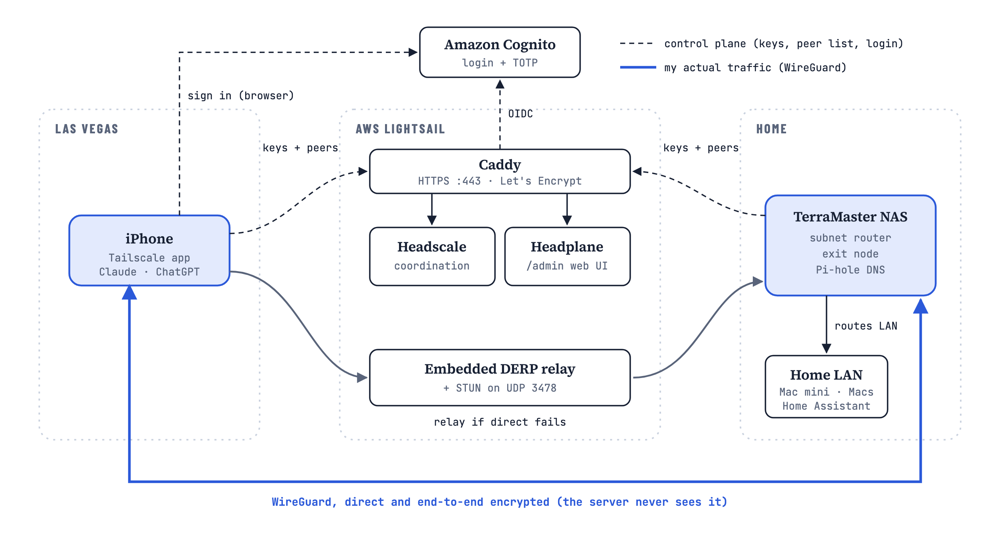

# headscale-cdk

A self-hosted Tailscale control plane for about **$7.50 a month**, as one AWS CDK (TypeScript) stack:

- **Headscale** `0.29.7`: the coordination server, with an embedded DERP relay and STUN
- **Headplane** `0.8.2`: the web admin UI at `/admin`
- **Caddy** `2.11.9`: automatic Let's Encrypt TLS and the reverse proxy
- **Cognito**: the OIDC identity provider for both, via one shared app client
- **Lightsail** `micro_3_0` (1 GB, Ubuntu 24.04) with a static IP, daily auto-snapshots and a Route 53 A record

```
                  https://hs.example.com
 phone/laptop/NAS ───────────────▶ Caddy :443 ──┬─ /admin*  ─▶ Headplane :3000 ──▶ Docker socket (restart headscale)
   (tailscale)    ── UDP 3478 ──▶ Headscale     └─ /*       ─▶ Headscale :8080  (/ts2021, /derp, /oidc, ...)
                                       │
                         Cognito (managed login, TOTP MFA) ◀── OIDC (code + PKCE) ── Headscale & Headplane
```



Background for each decision, and everything that broke on the first real deploy, is in [docs/BUILD-NOTES.md](docs/BUILD-NOTES.md).

> Built for one person's home lab and running in production for exactly that. It's a working reference, not a managed product: read the scripts before you run them.

## Cost (us-east-1, Nov 2026)

| Item | Monthly |
|---|---|
| Lightsail `micro_3_0`: 1 GB RAM, 40 GB SSD, 2 TB transfer, public IPv4 included | $7.00 |
| Static IP (free while attached) | $0.00 |
| Auto-snapshots, 7 daily, billed on stored GB | ~$0.25–1.00 |
| Route 53 queries (hosted zone assumed to exist already; $0.50 if new) | <$0.05 |
| Cognito Essentials, under 10k MAU | $0.00 |
| Optional health alarm (`alertEmail`): Route 53 health check + CloudWatch alarm | ~$0.60 |
| **Total** | **≈ $7.50–8** |

DERP relay traffic counts toward the 2 TB allowance. Most connections go direct peer-to-peer.

## Prerequisites

- Node 20 or newer, AWS CLI v2, and an account bootstrapped for CDK (`npx cdk bootstrap`)
- A Route 53 public hosted zone for your domain
- `ssh` and `python3` on your machine, for the scripts

## Configure

```bash
npm ci
cp config.example.json config.local.json   # untracked; holds your domain, email, IP
```

| Key | Meaning |
|---|---|
| `hostedZoneName` | Route 53 zone, e.g. `example.com` |
| `recordName` | Control-plane FQDN, e.g. `hs.example.com` |
| `allowedUsers` | Emails Headscale accepts via OIDC; the first one gets the admin-user command |
| `cognitoDomainPrefix` | `<prefix>.auth.<region>.amazoncognito.com`; globally unique, no `aws`/`amazon`/`cognito` |
| `bundleId` | Default `micro_3_0`; `small_3_0` is 2 GB at $12 |
| `sshCidrs` | CIDRs allowed on TCP 22 (`[]` closes direct SSH) |
| `allowLightsailConnect` | Also allow Lightsail's browser-SSH ranges (still requires IAM) |
| `magicDnsBaseDomain` | Tailnet DNS suffix, default `tailnet.internal`; must not contain `recordName` |
| `nameservers` | Global DNS for clients; later, your Pi-hole's tailnet IP |
| `snapshotTimeOfDay` | UTC `HH:00` |
| `mfa` | `required` (default; prompts TOTP enrollment at sign-in) or `optional` |
| `disableApiKeyLogin` | Hide Headplane's API-key login (OIDC only). Default `true` |
| `pinnedUserDataFingerprint` | See [the replacement guard](#the-replacement-guard) |

Any key can also be passed as `-c key=value` (lists as JSON or comma-separated).

## Deploy

```bash
export AWS_PROFILE=... AWS_REGION=us-east-1
npm test && npx cdk synth
npx cdk deploy
```

Then deliver the OIDC secret. This starts Headscale, creates Headplane's API key, and starts Headplane:

```bash
./scripts/bootstrap-secret.sh Headscale
```

What it does:
1. Reads the client secret from Cognito with *your* credentials.
2. Gets a short-lived SSH certificate from Lightsail (`get-instance-access-details`); no key pair is stored anywhere.
3. Waits for cloud-init, then pipes the secret over SSH stdin into `/opt/headscale/secrets/oidc_client_secret` (0600).
4. A systemd `.path` unit sees the file and runs `hs-bootstrap.sh`. That script fills the DERP IPv4, starts Caddy and Headscale, waits for `headscale health`, runs `headscale apikeys create --expiration 999d` once, and starts Headplane.

To rotate the secret, regenerate it in Cognito and re-run the script.

Finally, pin the fingerprint printed in the `UserDataFingerprint` output into `config.local.json` as `pinnedUserDataFingerprint`.

### Why the secret travels over SSH

Lightsail has no instance roles, so something has to carry the secret. Of the three options:

- **User data:** the secret would land in CFN-resolved properties, instance metadata (any process can read it via IMDS) and cloud-init logs. And since CFN `UserData` is replace-on-update, every rotation would mean a new instance.
- **SSM plus an IAM user:** you would still have to get a long-lived access key onto the box. That key is a worse secret than the one it protects.
- **SSH push (chosen):** the secret only exists in Cognito and in a root-only file on the box. Port 22 is limited to `sshCidrs` and Lightsail-connect, and the SSH cert expires in minutes.

The other two secrets never leave the box. The Headplane cookie secret comes from `openssl rand -hex 16` at first boot, and the Headscale API key is created by bootstrap. Headplane reads all three through `*_path` keys, so its config file contains no secrets. Secrets Manager isn't used, which avoids $0.40/month per secret.

## Create your Cognito user

Copy the `CreateAdminUserCommand` stack output. It looks like this:

```bash
aws cognito-idp admin-create-user --region us-east-1 --user-pool-id us-east-1_XXXX \
  --username you@example.com \
  --user-attributes Name=email,Value=you@example.com Name=email_verified,Value=true \
  --desired-delivery-mediums EMAIL
```

`email_verified=true` is required. Headscale's `allowed_users` only matches verified emails, and without it login fails with a vague error. Cognito emails a temporary password, and you'll set a new one on first login.

**MFA:** with `mfa: "required"` (the default), managed login shows a TOTP QR code on your next sign-in. Scan it with any authenticator (1Password: edit the login → add a One-Time Password field → scan the QR code). With `mfa: "optional"`, the hosted UI never offers enrollment.

## Log into Headplane

Open `https://hs.example.com/admin`, choose **Sign in with SSO**, and complete Cognito login. The **first** OIDC user becomes **Owner**. Later users get `member`, which has no UI access, until an owner promotes them. Because Headscale and Headplane share one client, your Headplane account links to your Headscale user automatically once you've logged a device in.

If OIDC breaks while `disableApiKeyLogin` is true: SSH in, set `disable_api_key_login: false` in `/opt/headscale/headplane/config.yaml`, then run `docker compose restart headplane`. The API key is at `/opt/headscale/secrets/headscale_api_key`.

## Connect devices

**iPhone / iPad:** in the Tailscale app, open Settings → Accounts, tap the `…` menu → **Use custom coordination server**, enter `https://hs.example.com`, then sign in through Cognito.

**macOS** (App Store or standalone app): Option-click the menu bar icon → Debug → Custom Login Server. Or with the CLI: `tailscale login --login-server https://hs.example.com`.

**Linux:** `sudo tailscale up --login-server https://hs.example.com`, then open the printed URL and sign in.

**Headless devices** (no browser): create a short-lived pre-auth key.

```bash
./scripts/ssh.sh Headscale hs users list                       # find your user ID
./scripts/ssh.sh Headscale hs preauthkeys create --user <ID> --expiration 1h
# on the device:
tailscale up --login-server https://hs.example.com --authkey <KEY>
```

## NAS as subnet router + exit node

On a Linux NAS (or a Docker app on TerraMaster TOS / Synology / Unraid). Pre-auth keys:
`./scripts/ssh.sh Headscale hs preauthkeys create --user <ID> --expiration 1h`. Keys are single-use by default.

```yaml
# compose.yaml on the NAS ("2.2" works with Docker 17.05 / docker-compose 1.27)
version: "2.2"
services:
  tailscale:
    image: tailscale/tailscale:v1.104.7
    container_name: tailscale
    network_mode: host
    cap_add: [NET_ADMIN, NET_RAW]
    devices: ["/dev/net/tun:/dev/net/tun"]
    volumes: ["./state:/var/lib/tailscale"]
    env_file: [.env]                 # TS_AUTHKEY=... for first login; empty it afterwards
    environment:
      TS_STATE_DIR: /var/lib/tailscale
      TS_USERSPACE: "false"
      TS_ACCEPT_DNS: "false"         # if the NAS *is* your DNS server, don't loop it through the tailnet
      TS_ROUTES: "192.168.1.0/24"    # your LAN
      TS_HOSTNAME: nas
      TS_EXTRA_ARGS: "--login-server=https://hs.example.com --advertise-exit-node"
    restart: unless-stopped
```

The host needs `net.ipv4.ip_forward=1` (and `net.ipv6.conf.all.forwarding=1` for an IPv6 exit node).

**Old NAS Docker** (TerraMaster TOS 3 ships Docker 17.05) can't pull current images. The CA bundle is too old for Docker Hub, and the engine predates OCI indexes. Side-load instead:
`python3 tools/fetch-image.py tailscale/tailscale v1.104.7 ts.tar && cat ts.tar | ssh nas docker load`.

Then **approve** the routes, either in Headplane (Machines → nas → Routes) or with the CLI:

```bash
./scripts/ssh.sh Headscale hs nodes list-routes
./scripts/ssh.sh Headscale hs nodes approve-routes -i <NODE_ID> -r 192.168.1.0/24,0.0.0.0/0,::/0
```

Clients opt in with `tailscale set --accept-routes` (Linux; on by default for Apple and mobile) and pick the exit node in the app.

## A Mac without root (userspace mode)

If you can't install the app or run `sudo`, `tailscaled` runs as a user LaunchAgent with
`--tun=userspace-networking --socket=<dir>/tailscaled.sock --statedir=<dir> --socks5-server=localhost:1055 --outbound-http-proxy-listen=localhost:1055`.
Inbound tailnet connections reach local services. Outbound tailnet traffic needs the SOCKS/HTTP proxy, and macOS DNS isn't changed.

## Point tailnet DNS at Pi-hole

1. Join the Pi-hole host to the tailnet (above) and note its `100.x` IP.
2. Set the tailnet nameserver to it. **Don't redeploy for this**, because it changes user data. Use Headplane → DNS, or edit `dns.nameservers.global` in `/opt/headscale/config/config.yaml` and `docker restart headscale`.
3. Make Pi-hole answer tailnet clients. Its default `LOCAL` listening mode drops queries from `100.64.0.0/10`, because tailnet clients aren't on a directly attached subnet. Two options:
   - **Simple:** Settings → DNS → *Permit all origins*. This is fine if Pi-hole's port 53 is never exposed to the internet.
   - **Tighter (what I run):** `FTLCONF_dns_listeningMode: NONE` plus
     `FTLCONF_misc_dnsmasq_lines: "listen-address=127.0.0.1,<LAN IP>,<tailnet IP>;bind-dynamic"`.
     It binds only those addresses. `bind-dynamic`, not `bind-interfaces`, so Pi-hole still starts before `tailscale0` exists.
4. `override_local_dns: true` (already set) makes clients use it on any network. The catch: if that Pi-hole is at home and home goes dark, remote devices lose **all** DNS. [extras/backup-pihole](extras/backup-pihole/README.md) adds a tailnet-only backup Pi-hole on the Lightsail box as a second nameserver.

Why not just use Pi-hole's LAN IP through the subnet route? Subnet-routed traffic is masqueraded, so Pi-hole would log every remote query as coming from the router. It also breaks on networks that reuse your LAN range.

## Access policy

`policy.mode` is `database`, so Headplane's Access Control page can edit it. To keep it in a file instead:

```bash
cp policy/policy.example.hujson policy.local.hujson    # gitignored; set your email + LAN
./scripts/policy.sh Headscale policy.local.hujson --check
./scripts/policy.sh Headscale policy.local.hujson       # backs up the current policy, then applies
```

The example allows all traffic between your devices, which suits a one-person tailnet. It also auto-approves your LAN route and exit node, so re-registering the NAS needs no manual approval, and it allows Tailscale SSH to your own devices (`tailscale set --ssh` on each node). OIDC users are referenced by email.

## Health alert

Set `alertEmail` and deploy. Route 53 probes `https://<recordName>/health` every 30 seconds from several regions. After 3 failed minutes, a CloudWatch alarm emails you, and it emails again on recovery. Confirm the SNS subscription email first. This matters because a down control plane is quiet: existing tunnels keep working, but new logins, key refreshes and route or DNS changes stop.

## Upgrades

Change images **in place**. Never redeploy a template change onto an existing instance (see the guard below).

```bash
./scripts/upgrade.sh Headscale headscale 0.30.0   # ONE minor at a time: 0.29.x -> 0.30.x -> 0.31.x
./scripts/upgrade.sh Headscale headplane 0.8.3
./scripts/upgrade.sh Headscale caddy 2.11.10-alpine
```

The script takes a manual Lightsail snapshot, copies `db.sqlite`, edits the tag in `/opt/headscale/docker-compose.yaml`, pulls, restarts, and shows logs. Before each Headscale minor, read its [release notes](https://github.com/juanfont/headscale/releases) (config keys get renamed and DB migrations run on start) and check that Headplane supports that Headscale version. OS patches arrive via Ubuntu's `unattended-upgrades`.

### The replacement guard

CloudFormation **replaces** a Lightsail instance whenever `UserData` changes, and user data includes the rendered configs and image tags. Synth fingerprints the user data. If `pinnedUserDataFingerprint` is set and differs, synth fails unless you pass `-c replaceInstance=true`. Use that only when you mean to rebuild (snapshot first). Each rebuild also gets a **new Let's Encrypt certificate**, since Caddy's cert volume lives on the instance, and Let's Encrypt allows 5 duplicate certificates per week for the same name. `lib/versions.ts` describes what **fresh** installs get.

## Backup and restore

- **Automatic:** Lightsail keeps 7 daily snapshots of the whole instance at `snapshotTimeOfDay` UTC.
- **Ad hoc:** `aws lightsail create-instance-snapshot --instance-name headscale --instance-snapshot-name manual-$(date +%F)`
- **App-level:** everything stateful is in `/var/lib/headscale` (SQLite DB plus Noise and DERP keys), `/var/lib/headplane`, `/opt/headscale/config` and `/opt/headscale/secrets`. To copy it off:
  `./scripts/ssh.sh Headscale "sudo tar czf - /var/lib/headscale /var/lib/headplane /opt/headscale" > hs-backup.tgz`

**Restore from a snapshot.** In Lightsail, create an instance from the snapshot, move the static IP to it (`aws lightsail attach-static-ip`), and delete the broken one. DNS and node keys keep working because the IP and `noise_private.key` are unchanged. CloudFormation will then see drift on the instance. Either keep managing it by hand, or import it.

**Losing `noise_private.key` re-keys the control plane, and every node must log in again.** Back it up.

## Day-to-day

```bash
./scripts/ssh.sh Headscale                          # shell
./scripts/ssh.sh Headscale hs nodes list            # headscale CLI
./scripts/ssh.sh Headscale sudo docker compose -f /opt/headscale/docker-compose.yaml logs -f headscale
```

## Teardown

`npx cdk destroy` removes the instance, static IP and DNS record. The Cognito pool is **retained**, with deletion protection on. Remove it by hand if you mean it. Snapshots also outlive the instance, so delete them to stop paying.

## Verified on the first deploy

- Cognito OIDC works for both Headscale (`/oidc/callback`, PKCE S256) and Headplane (`/admin/oidc/callback`, `client_secret_basic`), using one shared client.
- Managed login v2 with `mfa: required` walks you through TOTP enrollment at first sign-in.
- Caddy passes the `/ts2021` Noise upgrade and `/derp` through with no extra config. Clients choose the embedded DERP as home.
- Lightsail `Networking.Ports` replaces the default firewall, and the static IP follows a replaced instance.

## Caveats

- **Headplane `config_strict`:** declared in the 0.8.2 schema but never read, so it has no effect.
- **Headplane `oidc.redirect_uri`:** deprecated in 0.8.x. The redirect URI is derived from `server.base_url`.
- **Headplane 0.8.2 rejects a disabled `integration.kubernetes` block** without `pod_name`, so the template omits it.
- **Lightsail runs user data under `/bin/sh`**, with its own script prepended, so a bash shebang is ignored. The template is a POSIX wrapper that runs the real script with bash.
- **Lightsail user data size:** the rendered script is ~14 KB. EC2's limit is 16 KB; Lightsail's isn't documented.
- **Headplane's Docker integration** restarts Headscale after DNS edits, and comments in Headscale's config may be lost when it rewrites the file.
- **`sshCidrs` pins SSH to an IP.** If your home IP changes, use Lightsail's browser SSH (`allowLightsailConnect`) or update the config and deploy. That changes only the firewall, not the instance.

## License

Apache-2.0. See [LICENSE](LICENSE).
